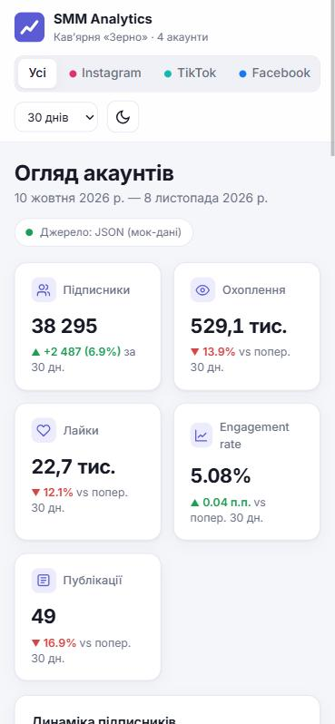

# SMM Analytics — дашборд статистики соцмереж

Односторінковий вебзастосунок (MVP) для аналізу акаунтів у соцмережах: кількість підписників, охоплення, лайки,
engagement rate (ER), графіки динаміки та рейтинг найкращих публікацій. Працює як статичний сайт і
розгортається на **GitHub Pages**. Дані поки що беруться з JSON-файлів (мок-дані), структура яких відповідає
таблицям бази **Azure SQL Database**, у яку планується перенести дані.


## Можливості

- **KPI-картки:** підписники (і приріст за період), охоплення, лайки, середній ER, кількість публікацій. Для кожного показника є порівняння з попереднім періодом такої самої довжини.
- **Фільтри:** платформа (усі, Instagram, TikTok, Facebook, YouTube) і період (7, 30, 90, 180 днів). Фільтри зберігаються між відвідуваннями і передаються в URL, наприклад `?platform=tt&days=90`, тому посиланням на конкретний зріз можна поділитися.
- **Графіки** (Chart.js):
  - динаміка підписників по платформах;
  - охоплення та взаємодії: по днях для коротких періодів, по тижнях для довших;
  - структура взаємодій: лайки, коментарі, репости, збереження;
  - порівняння платформ за середнім ER;
  - найкращі дні тижня для публікацій.
- **Рейтинг публікацій:** сортування за ER, охопленням, лайками, коментарями чи репостами; вибір 10, 20 або 50 записів; експорт у CSV.
- **Інтерфейс:** світла й темна тема та адаптивна верстка для телефона.

| Темна тема, TikTok, 90 днів | Мобільна версія |
|---|---|
|  |  |

## Як рахуються метрики

| Метрика | Формула |
|---|---|
| ER публікації | (лайки + коментарі + репости + збереження) / підписники на момент публікації × 100 |
| ER за період | середнє значення ER публікацій за період |
| Охоплення, лайки | сума денних значень за період |
| Підписники | значення на останній день періоду; приріст — різниця з першим днем |
| Динаміка | порівняння з попереднім періодом такої самої довжини (для 180 днів даних для порівняння немає) |

## Структура проєкту

```
smm-analytics/
├─ index.html                 розмітка сторінки
├─ assets/css/styles.css      стилі, світла й темна тема
├─ assets/js/
│  ├─ data.js                 шар доступу до даних (зараз читає JSON)
│  ├─ analytics.js            розрахунок KPI, рядів для графіків і рейтингу
│  ├─ charts.js               графіки Chart.js
│  └─ app.js                  стан, фільтри, рендеринг
├─ data/                      «база даних» MVP у JSON
│  ├─ accounts.json           → таблиця Accounts
│  ├─ daily_stats.json        → таблиця DailyStats (акаунт × день)
│  └─ posts.json              → таблиця Posts
├─ db/
│  ├─ schema.sql              схема для Azure SQL / SQL Server
│  └─ seed.sql                INSERT-и з мок-даними
├─ tools/
│  ├─ generate_data.py        генератор мок-даних
│  └─ json_to_sql.py          JSON → db/seed.sql
└─ .github/workflows/pages.yml  деплой на GitHub Pages
```

Уся робота з даними зосереджена в `assets/js/data.js`. Щоб перейти з JSON на справжній бекенд з Azure SQL,
достатньо замінити в ньому `fetch("data/*.json")` на виклики API. Решта коду не зміниться.

## Локальний запуск

Сторінка завантажує JSON через `fetch`, тому її треба відкривати через вебсервер, а не подвійним кліком по файлу:

```bash
python -m http.server 8090
```

Після цього відкрити http://localhost:8090.

Перегенерувати мок-дані та SQL-seed:

```bash
python tools/generate_data.py
python tools/json_to_sql.py
```

## Деплой на GitHub Pages

1. Створити репозиторій на GitHub і запушити вміст цієї теки в гілку `main`.
2. У репозиторії відкрити **Settings → Pages → Source** і вибрати **GitHub Actions**.
3. Workflow `.github/workflows/pages.yml` сам опублікує сайт після кожного push. Адреса: `https://<user>.github.io/<repo>/`.

## База даних Azure SQL

Для системи розгорнуто базу **Azure SQL Database** за безкоштовною пропозицією Azure (free offer):

| Параметр | Значення |
|---|---|
| Підписка | Azure for Students |
| Група ресурсів | `rg-smm-analytics` |
| Сервер | `smm-analytics-sql-2611.database.windows.net` |
| База даних | `smm-analytics-db` |
| Регіон | France Central (дозволений політикою підписки) |
| Тариф | General Purpose, Serverless, Gen5, 2 vCore, 32 ГБ — **безкоштовно** (100 000 vCore-секунд і 32 ГБ на місяць) |
| Після вичерпання ліміту | автопауза до наступного місяця, плата за перевищення вимкнена (0 USD) |
| Автентифікація | лише Microsoft Entra ID (без SQL-паролів) |
| Мережа | публічна кінцева точка, брандмауер пропускає лише IP-адреси розробника, TLS 1.2 |

Схема `db/schema.sql` описує три таблиці (`Accounts`, `DailyStats`, `Posts`) і представлення
`vw_PostEngagement`, яке рахує ER за тією самою формулою, що й дашборд. Схему та мок-дані (`db/seed.sql`:
4 акаунти, 720 денних записів, 328 публікацій) завантажено в хмарну базу. Нижче — запит до представлення в
Query editor на порталі Azure, який повертає топ-публікації за ER. Скріншоти порталу Azure наведено у звіті
(не публікуються в репозиторії, бо містять облікові дані).

Завантажити схему й дані повторно (вхід через Microsoft Entra у вікні браузера):

```bash
sqlcmd -S tcp:smm-analytics-sql-2611.database.windows.net,1433 -d smm-analytics-db -G -U <login>@knute.edu.ua -N -f 65001 -i db/schema.sql,db/seed.sql
```

## Звіт

Звіт із дисципліни «Хмарні та GRID-технології» зберігається локально в `docs/report/` (у репозиторій не входить). Текст звіту записано в
`docs/report/content.py`, скріншоти в рамках браузера з адресою сторінки генерує `docs/report/make_frames.py`,
а збирає документ `docs/report/build.ps1` (потрібні Python і Microsoft Word):

```powershell
python docs/report/make_frames.py
./docs/report/build.ps1 -Template "<шлях до прикладу звіту .docx>"
```

## Наступні кроки

Наступний крок після MVP — невеликий API (наприклад, Azure Functions), який читатиме дані з цієї бази, і заміна
`fetch("data/*.json")` у `assets/js/data.js` на виклики цього API.
